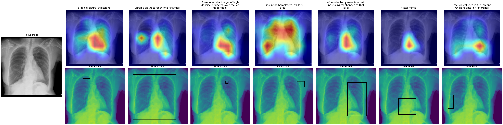
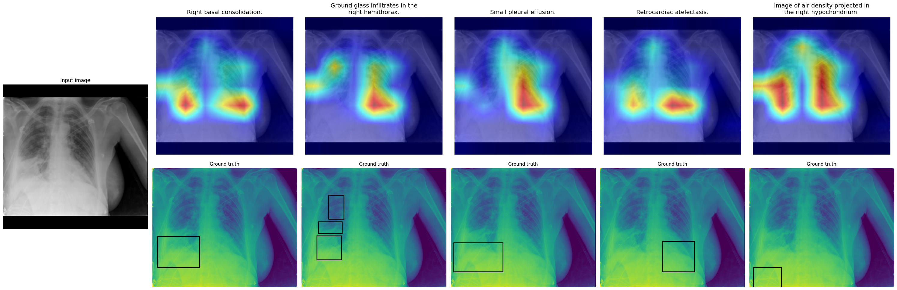

# Weakly Supervised Grounding: Initial Experiments

## 1. Background and Motivation

Weakly supervised grounding methods can struggle when an image contains multiple diseases or when the disease regions are small.

The [DAP](https://arxiv.org/abs/2505.15123) [1] paper highlights these limitations, but it does not clearly establish whether its method improves performance on these specific issues. It would be interesting to investigate whether DAP improves grounding when there are multiple diseases or when the disease regions are small.

[1] Huy, Ta Duc, Duy Anh Huynh, Yutong Xie, et al. “Seeing the Trees for the Forest: Rethinking Weakly-Supervised Medical Visual Grounding.” arXiv:2505.15123. Preprint, arXiv, August 24, 2025. [https://doi.org/10.48550/arXiv.2505.15123](https://doi.org/10.48550/arXiv.2505.15123).

## 2. Initial Experiment

A quick experiment was conducted using a subset of the [PadChest-GR](https://ai.nejm.org/doi/full/10.1056/AIdbp2401120) dataset. The charts from the DAP [1] were produced stratifying dice score across disease findings and size, using [ChezXero](https://www.nature.com/articles/s41551-022-00936-9) and [Chefer](https://ieeexplore.ieee.org/document/9710570) interpretability method. Results show similar trends to those observed in the DAP paper. Multiple qualitative examples were also investigated to better understand the model's grounding behaviour and identify potential failure modes.

- **Dataset:** 129 records, of which 76 contain disease findings.
- **Model:** [CheXzero](https://www.nature.com/articles/s41551-022-00936-9) pretrained weights.
- **Interpretability method:** [Chefer et. al](https://ieeexplore.ieee.org/document/9710570).

*Figure 1:* Dice score for disease findings

*Figure 2:* Dice score for disease size

## 4. Qualitative Examples

### Example 1: Poor localisation

`image_id=101354916913099012081924155376991837012_81ss65.png`

**Finding:** Left pleural effusion.

- The image contains a single disease finding, left pleural effusion.
- The interpretability map localises the disease entirely in the right lung, opposite to the expected location.
- The Dice score against the ground-truth region is 0 at thresholds of 0.3, 0.4, and 0.5.

This example may be one where the DAP method improves grounding. It is also a likely case where the background (BG) tokens are associated with the global text token.

Several aspects of this example are interesting:

- **Poor localisation:** The interpretability map is located in the opposite lung, despite the image containing only one disease finding.
- **Limited response to changes in the text:** The interpretability map changes very little when the text description changes. For example, using morphological descriptions of the disease does not improve localisation.
- **High confidence despite poor grounding:** CheXzero correctly predicts the original text description with approximately 99% confidence, based on scaled logits passed through softmax. However, the interpretability map does not correctly localise the disease.

*Figure 3:* Interpretability map for ground truth "Left pleural effusion" and other textual descriptions ("right pleural effusion" to align with interpret map, morphological description of pleural effusion, unrelated anatomical references) note the minimal change across the interpretability map

### Example 2: Multiple GT diseases (5), interpretability map dominated by single disease region

`image_id=101120174235725780234709445792984239056_2oib6d.png`

**Findings:** 7 disease findings.

- The overall Dice scores are poor.
- The image contains a mixture of very small and large disease regions.
- The model performs poorly overall.
- A highly salient region corresponds to a hiatal hernia, and this region dominates the interpretability map for other diseases.

*Figure 4:* Interpretability map for all ground truth findings

### Example 3: Multiple GT diseases (7), interpretability map dominated by single disease region

`image_id=101126299944644944835561376898203180176_2_o5vjuy.png`

**Findings:** 5 disease findings.

- The overall Dice scores are poor.
- A highly salient region corresponding to retrocardiac atelectasis appears across the interpretability maps for all findings.

*Figure 5:* Interpretability map for all ground truth findings

## 5. Next steps

- Reproduce the dice scores stratified by disease size and finging count with DAP weights - how much does DAP improve grounding when images contain multiple disease findings? 
- It would also be useful to investigate whether the relationships between diseases affect grounding performance, consider performance under these scenarios:
    - **Correlated disease**: When multiple diseases frequently occur together in the same image, potentially in different spatial regions. For example, if one disease often appears alongside another, the model may learn their co-occurrence rather than learning to localise each disease independently. 
    - **Independent diseases**: Two diseases occur independently, with less association between their presence in the same image. The model may be better able to learn their individual spatial locations if sufficient training examples exist for each disease independently.

## Ideas

- Investigate the research on healthy chest x-ray reconstruction, and see whether it is possible to reconstruct multiple findings chest x-rays to isolated examples of findings, this could lead to better visual grounding if only a single disease is present in the reconstructed image.