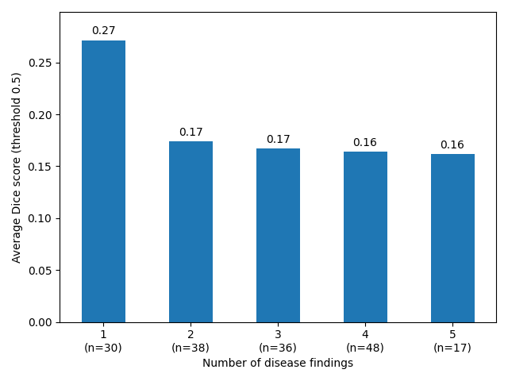
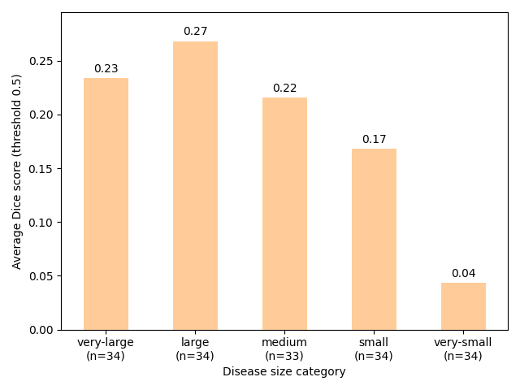

# Weakly Supervised Grounding: Initial Experiments

## 1. Background and Motivation

Weakly supervised grounding methods can struggle when an image contains multiple diseases or when the disease regions are small.

The DAP paper highlights these limitations, but it does not clearly establish whether its method improves performance on these specific issues. It would be interesting to investigate whether DAP improves grounding when there are multiple diseases or when the disease regions are small.

## 2. Initial Experiment

A quick experiment was conducted using a subset of the PadChest-GR dataset.

- **Dataset:** 129 records, of which 76 contain disease findings.
- **Model:** CheXzero pretrained weights.
- **Interpretability method:** Chefer.

The aim was to investigate how well the interpretability maps localise disease regions and whether grounding performance changes with the number of diseases or the size of the disease regions.

## 3. Initial Findings

Trends in Dice scores were observed across the PadChest-GR subset in relation to:

- The number of disease findings in an image.
- The size of the disease regions.

Multiple qualitative examples were also investigated to better understand the model's grounding behaviour and identify potential failure modes.

*Figure 1* Dice score for disease findings

*Figure 2* Dice score for disease size

## 4. Qualitative Examples

### Example 1: Poor localisation

`image_id=101354916913099012081924155376991837012_81ss65.png`

**Finding:** Left pleural effusion.

- The image contains a single disease finding, left pleural effusion.
- The interpretability map localises the disease entirely in the right lung, opposite to the expected location.
- The Dice score against the ground-truth region is 0 at thresholds of 0.3, 0.4, and 0.5.

This example may be one where the DAP method improves grounding. It is also a likely case where the background (BG) tokens are associated with the global text token.

Several aspects of this example are interesting:

- **Poor localisation:** The interpretability map is located in the opposite lung, despite the image containing only one disease finding.
- **Limited response to changes in the text:** The interpretability map changes very little when the text description changes. For example, using morphological descriptions of the disease does not improve localisation.
- **High confidence despite poor grounding:** CheXzero correctly predicts the original text description with approximately 99% confidence, based on scaled logits passed through softmax. However, the interpretability map does not correctly localise the disease.

*Figure 3: Interpretability map for ground truth "Left pleural effusion" and other textual descriptions ("right pleural effusion" to align with interpret map, morphological description of pleural effusion, unrelated anatomical references) note the minimal change across the interpretability map*

### Example 2: Multiple GT diseases (5), interpretability map dominated by single disease region

`image_id=101120174235725780234709445792984239056_2oib6d.png`

**Findings:** 7 disease findings.

- The overall Dice scores are poor.
- The image contains a mixture of very small and large disease regions.
- The model performs poorly overall.
- A highly salient region corresponds to a hiatal hernia.

This example raises questions about how the model handles multiple findings with different spatial sizes and whether some findings dominate the interpretability map.

### Example 3: Multiple GT diseases (7), interpretability map dominated by single disease region

`image_id=101126299944644944835561376898203180176_2_o5vjuy.png`

**Findings:** 5 disease findings.

- The overall Dice scores are poor.
- A highly salient region corresponding to retrocardiac atelectasis appears across the interpretability maps for all findings.

This raises the question of whether the model can distinguish between different diseases when multiple findings are present in the same image, or whether one salient region dominates the grounding regardless of the disease description provided

## 5. Investigating Whether DAP Improves Grounding with Multiple Diseases

An important next step is to investigate whether DAP improves grounding when images contain multiple disease findings. It would also be useful to investigate whether the relationships between diseases affect grounding performance.also

### Correlated vs. Independent Diseases

Two situations could be compared:

**1. Correlated diseases**
Two diseases frequently occur together in the same image, potentially in different spatial regions. For example, if one disease often appears alongside another, the model may learn their co-occurrence rather than learning to localise each disease independently. This could make grounding more difficult because the model may associate the text description of one disease with the region corresponding to the other.

**2. Independent diseases**
Two diseases occur independently, with less association between their presence in the same image. The model may be better able to learn their individual spatial locations if sufficient training examples exist for each disease independently.

### Research Direction

TODO: investigate what research has been done for weakly supervised visual grounding for multiple/complex disease cases regions
- How does DAP improve on these cases?
- When two correlated diseases appear in different spatial regions, can the model distinguish between their respective locations?
- Does the model rely on disease co-occurrence rather than learning the individual spatial features of each disease?
